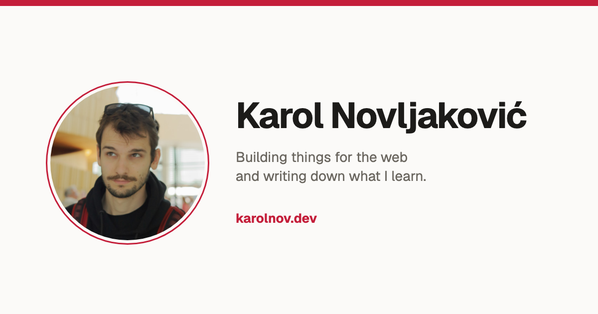

# karolnov.dev

[](https://karolnov.dev)

Source for **[karolnov.dev](https://karolnov.dev)**, my personal site and blog. I build things for the web
and write here about what I learn: sync engines, collaboration and working with AI.

It's built with [Astro](https://astro.build) and runs as a single [Cloudflare Worker](https://developers.cloudflare.com/workers/):
pages are prerendered and served as static assets, and the few routes that need a server run on demand at the edge.

## Worth a look

- **Interactive posts.** Posts are MDX, so they can embed live demos:
  - [Before you build a sync engine](https://karolnov.dev/blog/before-you-build-a-sync-engine/) has a two-client
    playground where you go offline, make conflicting edits and watch them merge
    ([`src/components/sync/`](src/components/sync/)).
  - [Show, don't prompt](https://karolnov.dev/blog/show-dont-prompt/) has animated chat and PR examples
    ([`src/components/ai/`](src/components/ai/)).
- **The About page.** A red ball rides a rail down the margin as you scroll and stretches into the
  highlight under each heading ([`src/scripts/scroll-ball.ts`](src/scripts/scroll-ball.ts)). My GitHub contribution
  graph loads in a [server island](https://docs.astro.build/en/guides/server-islands/) that's cached at the edge, with a
  build-time copy shown until it arrives.
- **Generated social cards.** Each post gets its own Open Graph image, rendered at build time with Satori and resvg
  ([`src/pages/og/[slug].png.ts`](src/pages/og/[slug].png.ts)).
- **A contact form with no third-party backend.** An [Astro Action](https://docs.astro.build/en/guides/actions/)
  validates the message, checks [Turnstile](https://developers.cloudflare.com/turnstile/) on the server (and fails closed),
  and sends it through [Cloudflare Email Routing](https://developers.cloudflare.com/email-routing/).
- **Light and dark themes** that follow your system, with a toggle that remembers your choice. Try the
  [404 page](https://karolnov.dev/nope) too.

## Stack

| | |
|---|---|
| Framework | Astro 7, MDX, content collections with typed frontmatter |
| Hosting | Cloudflare Workers via `@astrojs/cloudflare` (static assets + on-demand routes) |
| Contact form | Astro Actions, Turnstile, Email Routing `send_email` binding |
| Social images | Satori + resvg at build time |
| Feeds | RSS (`/rss.xml`) and sitemap |

## Layout

| Route | Rendering | Source |
|-------|-----------|--------|
| `/` | prerendered | [`src/pages/index.astro`](src/pages/index.astro) |
| `/about/` | prerendered, graph is a server island cached for 1 h, then stale-while-revalidate for a day | [`src/pages/about.astro`](src/pages/about.astro) |
| `/blog/`, `/blog/<slug>/` | prerendered | [`src/pages/blog/`](src/pages/blog/), posts in [`src/content/blog/`](src/content/blog/) |
| `/rss.xml`, `/sitemap-index.xml` | prerendered | [`src/pages/rss.xml.ts`](src/pages/rss.xml.ts), `@astrojs/sitemap` |
| `/contact/` | on demand | [`src/pages/contact.astro`](src/pages/contact.astro), [`src/actions/index.ts`](src/actions/index.ts) |

Set `draft: true` in a post's frontmatter to keep it out of production builds. Drafts still show in `npm run dev`.

## Running it locally

Needs Node 22.12 or newer.

```bash
npm install
cp .dev.vars.example .dev.vars
npm run dev
```

The dev server runs at `localhost:4321` inside workerd, so it behaves like production. `.dev.vars.example` holds
Cloudflare's Turnstile *test* keys, which always pass. Email is simulated locally: sent messages are logged and
written under `.wrangler/tmp/email/`.

| Command | What it does |
|---------|--------------|
| `npm run dev` | Dev server |
| `npm run build` | Build to `./dist/` |
| `npm run preview` | Build and run the production Worker locally |
| `npm run check` | Type-check `.astro` and `.ts` files |
| `npm run deploy` | Build and deploy with Wrangler |
| `npm run cf-typegen` | Regenerate `worker-configuration.d.ts` after editing `wrangler.jsonc` |

## Deploying your own copy

The config in [`wrangler.jsonc`](wrangler.jsonc) points at `karolnov.dev`, so change the route, `CONTACT_FROM` and
`TURNSTILE_SITEKEY` to your own first. Then:

1. Add your domain to your Cloudflare account and run `npx wrangler login`.
2. Turn on Email Routing and verify the inbox that should receive messages:
   `npx wrangler email routing enable <domain>`, then `npx wrangler email routing addresses create <inbox>`, and click
   the link in the verification email. Store the same address with `npx wrangler secret put CONTACT_TO`.
3. Create a Turnstile widget (managed mode) for your domain. Put its sitekey in `TURNSTILE_SITEKEY` and store the
   secret with `npx wrangler secret put TURNSTILE_SECRET`.
4. Run `npm run deploy`. Wrangler attaches the domain to the Worker and provisions the certificate.

## License

You're free to use anything here as long as you credit me. The code is [MIT](LICENSE), so keep the copyright
notice. The posts, photos and video are [CC BY 4.0](https://creativecommons.org/licenses/by/4.0/), so credit
Karol Novljaković and link to [karolnov.dev](https://karolnov.dev). The Geist fonts belong to Vercel and are under the
SIL Open Font License. The [LICENSE](LICENSE) file has the details.
